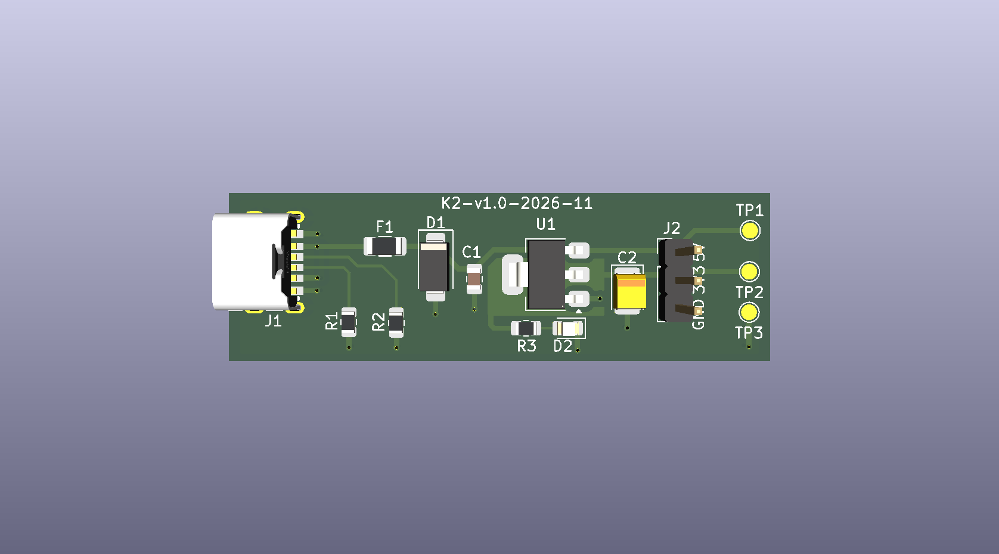
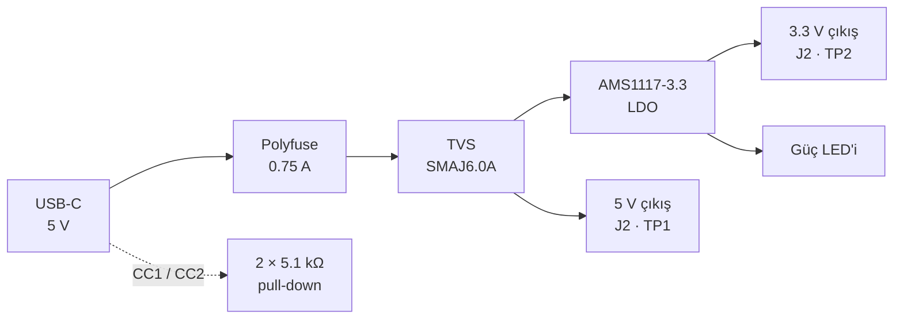
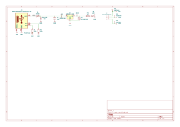
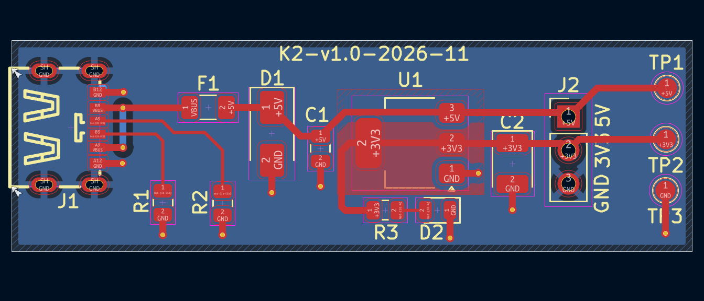
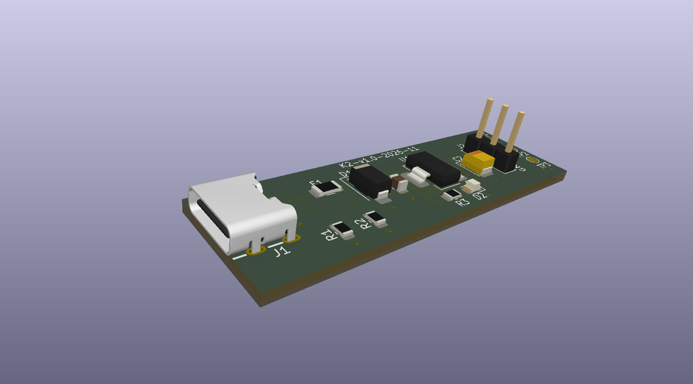
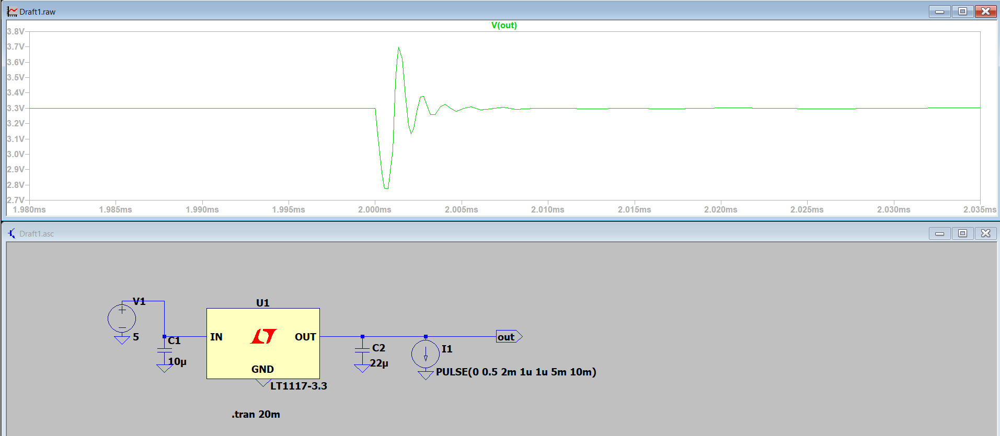

# K2 — USB-C 3.3 V Güç Kartı



USB-C'den aldığı 5 V'u korumalı biçimde 3.3 V'a düşüren, iki katmanlı küçük bir güç kartı.
Yol haritamdaki ilk "üretime hazır" kart: şema, PCB, üretim dosyaları ve doğrulama bu repoda.

> **Durum:** Tasarım tamamlandı · DRC temiz · Gerber hazır · Sipariş verilmedi (simülasyon + inceleme ile doğrulanıyor)

---

## Özellikler

| | |
|---|---|
| **Giriş** | USB-C, yalnız güç (6 pin), 5 V |
| **Çıkış** | 3.3 V, en az 500 mA · ayrıca 5 V çıkış |
| **Koruma** | Polyfuse (aşırı akım) + TVS diyot (gerilim darbesi, ESD) |
| **Gösterge** | 3.3 V hattında güç LED'i |
| **Bağlantı** | 1×3 pin header (5V, 3V3, GND) + 3 test noktası |
| **Kart** | 2 katman, 51.5 × 16 mm |

## Blok diyagram



## Şema



[Şemanın PDF hâli](docs/k2-schematic.pdf)

## PCB

| Üst yüz | Alt yüz |
|---|---|
|  |  |



---

## Malzeme listesi (BOM)

| Ref | Parça | LCSC | JLCPCB | Not |
|---|---|---|---|---|
| J1 | SHOU HAN TYPE-C 6P | C456012 | Extended | Yalnız güç, SMD, dik açılı, THT tırnaklı |
| R1, R2 | 5.1 kΩ %1 0805 | C27834 | Basic | CC1 / CC2 pull-down |
| F1 | FSMD075-1206R | C5144563 | Extended | Polyfuse, I_hold 0.75 A, V_max 8 V |
| D1 | SMAJ6.0A | C83329 | Extended | TVS, tek yönlü, V_R 6.0 V, V_C 10.3 V |
| C1 | 10 µF 25 V X5R 0805 | C15850 | Basic | LDO giriş kondansatörü |
| U1 | AMS1117-3.3 (SOT-223) | C6186 | Basic | 3.3 V LDO |
| C2 | 22 µF 10 V tantal (B kılıf) | C7198 | Extended | LDO çıkış kondansatörü, ESR 2.4 Ω |
| D2 | Kırmızı LED 0805 | C84256 | Basic | V_F 1.6–2.6 V |
| R3 | 1 kΩ %1 0805 | C17513 | Basic | LED akım direnci |
| J2 | 1×3 pin header, 2.54 mm | — | — | Dik, THT |
| TP1–TP3 | Test noktası | — | — | PCB pad'i |

---

## Tasarım kararları ve hesaplar

### Regülatör: neden AMS1117, neden AP2112K değil?

5 V → 3.3 V, 500 mA'de regülatörde harcanan güç:

**P = (5 − 3.3) × 0.5 = 0.85 W**

| | AMS1117-3.3 (SOT-223) | AP2112K-3.3 (SOT-23-5) |
|---|---|---|
| Dropout (maks.) | 1.3 V | 0.4 V |
| θJA | 90 °C/W | 184 °C/W |
| ΔT (0.85 W) | ≈ 77 °C | ≈ 156 °C |
| Tj (25 °C ortam) | ≈ 102 °C ✓ | ≈ 181 °C ✗ |

AP2112K dropout'ta çok daha iyi, ama küçük kılıfı 0.85 W'ı atamıyor: 25 °C ortamda en fazla ~320 mA verebilir.
500 mA gereksinimi için **AMS1117** seçildi. Bedeli: dropout payı az ve termal bakır alan şart.

### Termal hesap: Tj = Ta + P × θJA

| Ortam (Ta) | Tj | 125 °C sınırı |
|---|---|---|
| 25 °C | 101,5 °C | 125 °C sınırının altında |
| 40 °C | 116,5 °C | Sınıra yakın, pay az |
| 60 °C | 136,5 °C | 125 °C’yi aşıyor |

<!-- TODO: Hangi sıcaklıkta sınır aşılıyor, o durumda ne yapılmalı? -->

### Koruma

- **Polyfuse (0.75 A):** I_hold, 500 mA'lik yük akımının üstünde olmalı; sıcaklıkla düşen I_hold ve açılıştaki ani akımlar için ~%50 pay bırakıldı. V_max 8 V, darbe sırasında hattın kısa süre 5 V'u aşmasına karşı pay.
- **TVS (SMAJ6.0A):** USB-C'de VBUS 5.5 V'a kadar çıkabildiği için V_R ≥ 5.5 V olmalı → 5.0A yerine 6.0A. V_C = 10.3 V, AMS1117'nin maksimum giriş geriliminin altında. Hat hiç negatife düşmediği için **tek yönlü**; negatif darbeleri de ~−0.7 V'ta keser.

### Kondansatörler

- **C1 = 10 µF seramik:** AMS1117 datasheet'inin önerdiği değer. USB, cihazın VBUS hattındaki kapasiteyi 10 µF ile sınırlar (açılıştaki ani akım için). 25 V değer, DC bias kaybını azaltmak için.
- **C2 = 22 µF tantal:** AMS1117 kararlı çalışmak için çıkış kondansatöründe belirli bir ESR ister; çok düşük ESR'li seramik kondansatörle salınıma girebilir.

### CC dirençleri

<!-- TODO: 2–3 cümleyle kendi cümlelerinle yaz:
     1) Bu dirençler ne işe yarıyor?
     2) İkisini neden tek dirençle birleştiremeyiz?
     3) Hiç direnç koymazsan ne olur? -->

### Güç LED'i

R = (3.3 − V_F) / I → (3.3 − 2.0) / 1 kΩ ≈ **1.3 mA**.
Yeşil LED'in V_F değeri (2.6–3.1 V) 3.3 V'a çok yakın olduğu için kırmızı seçildi.

### PCB yerleşimi

- **İz genişlikleri:** güç hatları 0.5 mm (500 mA'de 30 mm'lik izde ≈ 15 mV düşüm), sinyal hatları 0.25 mm.
- **Alt katman kesintisiz GND düzlemi.** SMD GND pad'leri kendi via'larıyla düzleme iner.
- **USB-C'nin iki VBUS pad'i** (A9, B9) arada CC pad'leri olduğu için alt katmanda kısa bir izle birleştirildi.
- **TVS'nin GND via'sı** pad'in dibinde: darbe akımı en kısa yoldan düzleme gitsin.
- **AMS1117'nin tab'ı** (+3V3) üst katmanda katı bağlantılı bir bakır alana bağlı: termal soğutucu.
- **USB-C** kart kenarından taşacak şekilde yerleştirildi; fiş tam otursun.

---

## Doğrulama

| Kontrol | Sonuç |
|---|---|
| ERC (şema) | 0 hata |
| DRC (PCB) | 0 hata, 0 uyarı |
| Şema ↔ PCB paritesi | 0 fark |
| Bağlantısız öğe | 0 |
| İstisnalar | 2 — J1'in silkscreen'i kart kenarında kırpılıyor (konnektör bilerek kenardan taşıyor) |
| JLCPCB önizlemesi | 2 katman, 16 × 51.5 mm, sorun yok |

### LTspice: yük basamağı (0 → 500 mA)



<!-- TODO: Çıkış ne kadar düştü, ne kadar sürede toparlandı? (Model: LT1117-3.3) -->

---

## Üretim

- Gerber + delik dosyaları: [`gerber.zip`](gerber.zip)
- JLCPCB önizlemesi: 2 katman, 51.5 × 16 mm
- Tahmini maliyet (5 adet, 17 Kasım 2026): kart $4.10 + kargo ≈ $26


---

## Öğrendiklerim

- **Özet bilgiler çelişebilir, geçerli olan datasheet.** USB-C konnektörü için JLCPCB 3 A, LCSC 5 A diyordu.
- **Çok versiyonlu datasheet'lerde doğru tabloya bak.** AP2112K'nın dropout'unu ilk okumada 2.5 V'luk versiyonun tablosundan okudum.
- **3.3 V'ta yeşil, mavi ve beyaz LED sorunlu**: V_F'leri 3 V civarında.
- **İndirilen footprint'lerde pad numaralarını sembolle karşılaştır.** EasyEDA kılıf tırnaklarına `7` demişti, KiCad sembolü `SH` bekliyordu.
- **3D görünüm hata yakalar.** İndirilen 3D model 180° ters ve kaymıştı; footprint ise doğruydu.
- **AI'ın verdiği pin numarasını doğrula.** Kılıf pininin numarası bana `S1` olarak söylendi, gerçekte `SH`'ydi; KiCad'in hata mesajı yakaladı.

## v2 için notlar

- [ ] U1'i 180° döndür: küçük pinler girişe, tab çıkışa baksın. +5V ve +3V3 hatları U1'in etrafından dolaşmasın.
- [ ] Montaj delikleri ekle.
- [ ] Termal alanı büyüt; alt katmana termal via'lı bir +3V3 adacığı düşün.
- [ ] Daha düşük dropout'lu ve 500 mA'i kaldıran bir LDO araştır.

---

## Repo yapısı

```
k2-usbc-guc/
├── k2-usbc-guc.kicad_pro / .kicad_sch / .kicad_pcb
├── lib/            USB-C footprint, sembol ve 3D model (easyeda2kicad, C456012)
├── fp-lib-table    proje footprint kütüphanesi
├── gerber/         üretim dosyaları
├── gerber.zip
└── docs/           görseller, şema PDF'i
```

KiCad 10 ile tasarlandı.# K2 — USB-C 3.3 V Güç Kartı


USB-C'den aldığı 5 V'u korumalı biçimde 3.3 V'a düşüren, iki katmanlı küçük bir güç kartı.
Yol haritamdaki ilk "üretime hazır" kart: şema, PCB, üretim dosyaları ve doğrulama bu repoda.

> **Durum:** Tasarım tamamlandı · DRC temiz · Gerber hazır · Sipariş verilmedi (simülasyon + inceleme ile doğrulanıyor)

---

## Özellikler

| | |
|---|---|
| **Giriş** | USB-C, yalnız güç (6 pin), 5 V |
| **Çıkış** | 3.3 V, en az 500 mA · ayrıca 5 V çıkış |
| **Koruma** | Polyfuse (aşırı akım) + TVS diyot (gerilim darbesi, ESD) |
| **Gösterge** | 3.3 V hattında güç LED'i |
| **Bağlantı** | 1×3 pin header (5V, 3V3, GND) + 3 test noktası |
| **Kart** | 2 katman, 51.5 × 16 mm |

## Blok diyagram


## Şema


[Şemanın PDF hâli](docs/k2-schematic.pdf)

## PCB

| Üst yüz | Alt yüz |
|---|---|
|  |  |


---

## Malzeme listesi (BOM)

| Ref | Parça | LCSC | JLCPCB | Not |
|---|---|---|---|---|
| J1 | SHOU HAN TYPE-C 6P | C456012 | Extended | Yalnız güç, SMD, dik açılı, THT tırnaklı |
| R1, R2 | 5.1 kΩ %1 0805 | C27834 | Basic | CC1 / CC2 pull-down |
| F1 | FSMD075-1206R | C5144563 | Extended | Polyfuse, I_hold 0.75 A, V_max 8 V |
| D1 | SMAJ6.0A | C83329 | Extended | TVS, tek yönlü, V_R 6.0 V, V_C 10.3 V |
| C1 | 10 µF 25 V X5R 0805 | C15850 | Basic | LDO giriş kondansatörü |
| U1 | AMS1117-3.3 (SOT-223) | C6186 | Basic | 3.3 V LDO |
| C2 | 22 µF 10 V tantal (B kılıf) | C7198 | Extended | LDO çıkış kondansatörü, ESR 2.4 Ω |
| D2 | Kırmızı LED 0805 | C84256 | Basic | V_F 1.6–2.6 V |
| R3 | 1 kΩ %1 0805 | C17513 | Basic | LED akım direnci |
| J2 | 1×3 pin header, 2.54 mm | — | — | Dik, THT |
| TP1–TP3 | Test noktası | — | — | PCB pad'i |

---

## Tasarım kararları ve hesaplar

### Regülatör: neden AMS1117, neden AP2112K değil?

5 V → 3.3 V, 500 mA'de regülatörde harcanan güç:

**P = (5 − 3.3) × 0.5 = 0.85 W**

| | AMS1117-3.3 (SOT-223) | AP2112K-3.3 (SOT-23-5) |
|---|---|---|
| Dropout (maks.) | 1.3 V | 0.4 V |
| θJA | 90 °C/W | 184 °C/W |
| ΔT (0.85 W) | ≈ 77 °C | ≈ 156 °C |
| Tj (25 °C ortam) | ≈ 102 °C ✓ | ≈ 181 °C ✗ |

AP2112K dropout'ta çok daha iyi, ama küçük kılıfı 0.85 W'ı atamıyor: 25 °C ortamda en fazla ~320 mA verebilir.
500 mA gereksinimi için **AMS1117** seçildi. Bedeli: dropout payı az ve termal bakır alan şart.

### Termal hesap: Tj = Ta + P × θJA

| Ortam (Ta) | Tj | 125 °C sınırı |
|---|---|---|
| 25 °C | <!-- TODO --> | <!-- TODO --> |
| 40 °C | <!-- TODO --> | <!-- TODO --> |
| 60 °C | <!-- TODO --> | <!-- TODO --> |

<!-- TODO: Hangi sıcaklıkta sınır aşılıyor, o durumda ne yapılmalı? -->

### Koruma

- **Polyfuse (0.75 A):** I_hold, 500 mA'lik yük akımının üstünde olmalı; sıcaklıkla düşen I_hold ve açılıştaki ani akımlar için ~%50 pay bırakıldı. V_max 8 V, darbe sırasında hattın kısa süre 5 V'u aşmasına karşı pay.
- **TVS (SMAJ6.0A):** USB-C'de VBUS 5.5 V'a kadar çıkabildiği için V_R ≥ 5.5 V olmalı → 5.0A yerine 6.0A. V_C = 10.3 V, AMS1117'nin maksimum giriş geriliminin altında. Hat hiç negatife düşmediği için **tek yönlü**; negatif darbeleri de ~−0.7 V'ta keser.

### Kondansatörler

- **C1 = 10 µF seramik:** AMS1117 datasheet'inin önerdiği değer. USB, cihazın VBUS hattındaki kapasiteyi 10 µF ile sınırlar (açılıştaki ani akım için). 25 V değer, DC bias kaybını azaltmak için.
- **C2 = 22 µF tantal:** AMS1117 kararlı çalışmak için çıkış kondansatöründe belirli bir ESR ister; çok düşük ESR'li seramik kondansatörle salınıma girebilir.

### CC dirençleri

<!-- TODO: 2–3 cümleyle kendi cümlelerinle yaz:
     1) Bu dirençler ne işe yarıyor?
     2) İkisini neden tek dirençle birleştiremeyiz?
     3) Hiç direnç koymazsan ne olur? -->

### Güç LED'i

R = (3.3 − V_F) / I → (3.3 − 2.0) / 1 kΩ ≈ **1.3 mA**.
Yeşil LED'in V_F değeri (2.6–3.1 V) 3.3 V'a çok yakın olduğu için kırmızı seçildi.

### PCB yerleşimi

- **İz genişlikleri:** güç hatları 0.5 mm (500 mA'de 30 mm'lik izde ≈ 15 mV düşüm), sinyal hatları 0.25 mm.
- **Alt katman kesintisiz GND düzlemi.** SMD GND pad'leri kendi via'larıyla düzleme iner.
- **USB-C'nin iki VBUS pad'i** (A9, B9) arada CC pad'leri olduğu için alt katmanda kısa bir izle birleştirildi.
- **TVS'nin GND via'sı** pad'in dibinde: darbe akımı en kısa yoldan düzleme gitsin.
- **AMS1117'nin tab'ı** (+3V3) üst katmanda katı bağlantılı bir bakır alana bağlı: termal soğutucu.
- **USB-C** kart kenarından taşacak şekilde yerleştirildi; fiş tam otursun.

---

## Doğrulama

| Kontrol | Sonuç |
|---|---|
| ERC (şema) | 0 hata |
| DRC (PCB) | 0 hata, 0 uyarı |
| Şema ↔ PCB paritesi | 0 fark |
| Bağlantısız öğe | 0 |
| İstisnalar | 2 — J1'in silkscreen'i kart kenarında kırpılıyor (konnektör bilerek kenardan taşıyor) |
| JLCPCB önizlemesi | 2 katman, 16 × 51.5 mm, sorun yok |

### LTspice: yük basamağı (0 → 500 mA)


<!-- TODO: Çıkış ne kadar düştü, ne kadar sürede toparlandı? (Model: LT1117-3.3) -->

---

## Üretim

- Gerber + delik dosyaları: [`gerber.zip`](gerber.zip)
- JLCPCB önizlemesi: 2 katman, 51.5 × 16 mm
- Tahmini maliyet (5 adet, 17 Kasım 2026): kart $4.10 + kargo ≈ $26


---

## Öğrendiklerim

- **Özet bilgiler çelişebilir, geçerli olan datasheet.** USB-C konnektörü için JLCPCB 3 A, LCSC 5 A diyordu.
- **Çok versiyonlu datasheet'lerde doğru tabloya bak.** AP2112K'nın dropout'unu ilk okumada 2.5 V'luk versiyonun tablosundan okudum.
- **3.3 V'ta yeşil, mavi ve beyaz LED sorunlu**: V_F'leri 3 V civarında.
- **İndirilen footprint'lerde pad numaralarını sembolle karşılaştır.** EasyEDA kılıf tırnaklarına `7` demişti, KiCad sembolü `SH` bekliyordu.
- **3D görünüm hata yakalar.** İndirilen 3D model 180° ters ve kaymıştı; footprint ise doğruydu.
- **AI'ın verdiği pin numarasını doğrula.** Kılıf pininin numarası bana `S1` olarak söylendi, gerçekte `SH`'ydi; KiCad'in hata mesajı yakaladı.

## v2 için notlar

- [ ] U1'i 180° döndür: küçük pinler girişe, tab çıkışa baksın. +5V ve +3V3 hatları U1'in etrafından dolaşmasın.
- [ ] Montaj delikleri ekle.
- [ ] Termal alanı büyüt; alt katmana termal via'lı bir +3V3 adacığı düşün.
- [ ] Daha düşük dropout'lu ve 500 mA'i kaldıran bir LDO araştır.

---

## Repo yapısı

```
k2-usbc-guc/
├── k2-usbc-guc.kicad_pro / .kicad_sch / .kicad_pcb
├── lib/            USB-C footprint, sembol ve 3D model (easyeda2kicad, C456012)
├── fp-lib-table    proje footprint kütüphanesi
├── gerber/         üretim dosyaları
├── gerber.zip
└── docs/           görseller, şema PDF'i
```

KiCad 10 ile tasarlandı.